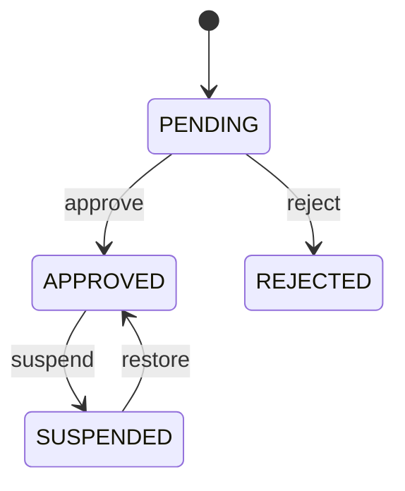

# Authentication design

## Account lifecycle and authorization

Public signup accepts name, email, password and organization slug. It validates a strict input schema, normalizes email and slug, and creates a pending employee using database defaults. The same 202 response covers new and duplicate email addresses for an existing organization. A missing slug returns 404. Registration is an application for membership. Administrators must establish membership independently before approving.

Login retrieves the hash through a dedicated model query, uses an asynchronous bcrypt comparison and performs a dummy comparison for unknown or deleted accounts. Wrong passwords and ineligible accounts share a generic 401 response. Passwords must be well-formed Unicode with at least 12 code points and at most 72 UTF-8 bytes. Whitespace is significant. The default bcrypt cost is 12.

Successful login returns a short-lived HS256 access token in a response marked `Cache-Control: no-store`. Verification checks the signature, algorithm, issuer, audience, expiration, issuance time and claim types. In addition to user and organization identifiers and standard claims, the token contains the account's `authVersion`. The middleware reloads the user by both identifiers, verifies that the account is approved and undeleted, and compares the signed version to the database value. The database supplies the current role. All protected responses use `Cache-Control: no-store`.

The additive migration initializes existing accounts at version zero. Tokens issued before this release lack the required claim. Clients must authenticate again after deployment. Suspension and restoration each increment the account version in their transaction, so restoration cannot make a pre-suspension token usable again. Role changes are effective on the next protected request because permissions use the database role.

Users can read and edit their own profiles. Administrators can read and edit users in their organization, list users, approve other pending accounts, and soft-delete non-administrators. Organization scope comes from the authenticated account. Cross-organization lookups return 404. Input and output allowlists constrain mutable and exposed fields.

### Permission matrix

| Operation | Employee | Safety officer | Administrator |
| --- | --- | --- | --- |
| Read profile or edit name | Own account | Own account | Any account in their organization |
| List users | Denied | Denied | Own organization |
| Approve account | Denied | Denied | Another pending account in their organization |
| Reject account | Denied | Denied | Pending non-administrator in their organization |
| Suspend account | Denied | Denied | Approved non-administrator in their organization |
| Restore account | Denied | Denied | Suspended, undeleted account in their organization |
| Change role | Denied | Denied | Approved non-administrator in their organization, between employee and safety officer |
| Soft-delete account | Denied | Denied | Non-administrator in their organization |
| Read audit logs | Denied | Denied | Own organization |

The centralized policy lookup denies unknown permissions and roles. Route middleware checks collection and administrator permissions. Ownership checks in services use records loaded from the database after applying the organization filter. Future modules can add explicit permissions to the same policy table and retain tenant filters in their model queries.

### Account lifecycle

Soft deletion is a separate operation. Suspension excludes the acting administrator and all other administrator targets. Restoration keeps the original approver and approval timestamp. The role endpoint only changes approved employees and safety officers, excludes self-edits, and never assigns the administrator role.

For example, an administrator sends `PATCH /api/v1/users/<id>/suspend` with their bearer token and no request body, then uses `PATCH /api/v1/users/<id>/restore` when the account is eligible again. Role changes use `PATCH /api/v1/users/<id>/role` with a JSON body such as `{"role":"EMPLOYEE"}`.

## Transactions and audit

Signup and its audit event share a transaction. A globally unique email index resolves concurrent inserts. Approval uses a conditional pending-to-approved update and writes its audit event in the same transaction. Profile edits and soft deletions also commit with their audit records. Soft deletion retains historical user and audit records. Administrator bootstrap creates the organization, administrator, and audit events together. The CLI verifies the configured local database and checks the actual PostgreSQL connection target before writing.

Rejection uses a conditional pending-to-rejected update that excludes administrator and deleted accounts. The status change and `ACCOUNT_REJECTED` audit event commit together.

All lifecycle updates check the prior status in the database write. Role updates check the previous role and approved status in their write. If suspension wins the row update first, the role change fails. If the role change wins first, suspension may still proceed. An audit failure rolls back the mutation, including a token-version increment.

Administrators can list events with `GET /api/v1/audit-logs` and read a scoped entry with `GET /api/v1/audit-logs/<id>`. For example, `GET /api/v1/audit-logs?action=USER_ROLE_CHANGED&entityType=User&limit=20` lists role changes. The API supports an actor ID and inclusive `from` and `to` timestamps. Results use bounded pagination and newest-first ordering with descending IDs as the tie-breaker. Records outside the administrator's organization return 404.

Metadata is filtered on write and read, including for older records. Safe fields are the existing counters and flags and, for role changes, the previous and new allowed roles. Access logs use route templates, HTTP method, response status and duration. Request URLs, query values, headers and bodies are excluded. API errors use fixed messages and infrastructure failures return sanitized HTTP 500 responses.

## Security limitations

- Use HTTPS outside loopback. Signed JWT payloads are readable. SafeOps has no refresh tokens, per-token logout, MFA, password recovery or email verification. A stolen bearer token for an eligible account is usable until expiry or account-level invalidation. Key replacement invalidates all tokens signed by the old key. Already-authorized requests can finish.
- In-memory rate limiting applies per connected IP and per instance. It resets on restart and does not stop distributed guessing. A multi-instance deployment needs a shared rate-limit store. Configure proxy trust explicitly if adding a reverse proxy.
- Generic 401 and 202 messages reduce email enumeration. Database work and different stored bcrypt costs can still influence timing. A missing organization slug is publicly distinguishable.
- Credential hashes use the configured bcrypt work factor at creation. Existing hashes retain their stored factor if the configuration changes.
