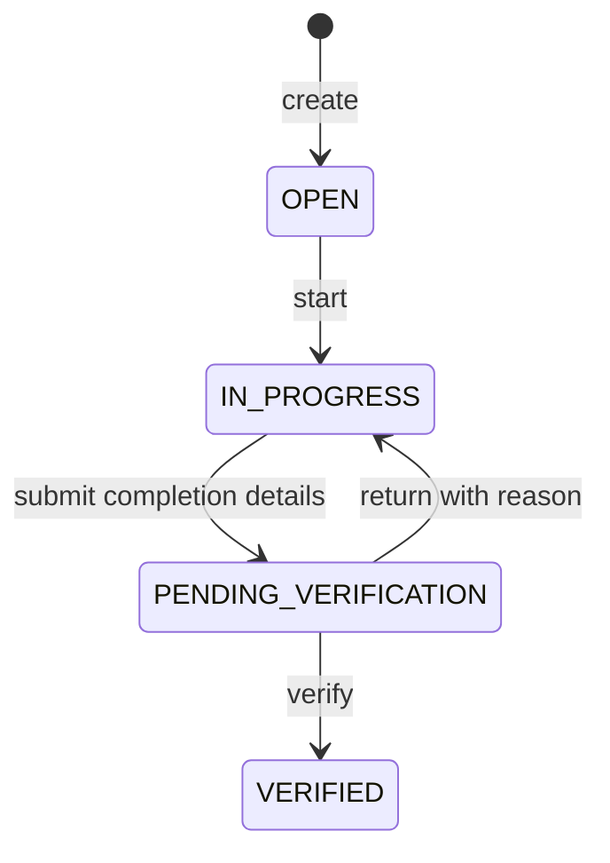

# Corrective action design

## Workflow

A safety officer or administrator creates one or more actions for a confirmed hazard with an existing risk assessment. An action starts as `OPEN` at version 1. The assignee or a manager can start work and submit completed work. A manager can verify a submission or return it with a reason. Verification requires a manager who is neither the current assignee nor the latest submitter.



Returning an action clears its current submission. The prior submission and return reason remain available in history. Managers can edit or reassign an `OPEN` or `IN_PROGRESS` action. An employee assignee can update `workNotes` while it is `IN_PROGRESS`. Verified actions are terminal.

## Permissions and visibility

| Operation | Employee | Safety officer or administrator |
| --- | --- | --- |
| Create or reassign | Denied | Own organization |
| List, read and view history | Actions assigned to them or linked to hazards they reported | Own organization |
| Edit action plan or due date | Denied | Own organization while open or in progress |
| Edit work notes | Assigned actions in progress | Own organization while open or in progress |
| Start or submit | Assigned actions | Own organization |
| Return | Denied | Pending submissions in own organization |
| Verify | Denied | Pending submissions in own organization, with an independent verifier |

An employee who only reported the hazard has read access to its actions. An employee assigned to an action can read that action and its history even if they cannot read the underlying hazard. This access does not carry over to the hazard, risk assessment, or other actions linked to the hazard. Action responses expose the hazard ID and action fields, without joined hazard, risk-assessment, or user details. Inaccessible action IDs and foreign hazard or assignment targets return 404.

Assignments require an approved, undeleted user in the same organization. If an assignee later becomes ineligible, the assignment remains visible in history and to managers. Starting or submitting work requires an eligible assignee, so a manager can reassign unfinished work before continuing. A submission already received can still be reviewed.

## Endpoints and examples

All paths are under `/api/v1/corrective-actions` and require a bearer token. Responses use the standard JSON envelope.

| Method and suffix | Input and result |
| --- | --- |
| `POST /` | `hazardId`, `assigneeId`, `title`, `description`, `dueAt`. Returns 201 with the new action. |
| `GET /` | Lists visible actions. Filter by `hazardId`, `assigneeId`, `status`, or `overdue`. |
| `GET /:id` | Returns the current action. |
| `GET /:id/history` | Returns events by version, newest first. |
| `PATCH /:id` | `version` plus at least one editable field. Returns the updated action. |
| `PATCH /:id/start` | `version`. Moves open work to in progress. |
| `PATCH /:id/submit` | `version` and `completionDetails`. Sends work for verification. |
| `PATCH /:id/verify` | `version`. Verifies pending work. |
| `PATCH /:id/return` | `version` and `reason`. Returns pending work to in progress. |

```http
POST /api/v1/corrective-actions
Authorization: Bearer <manager-token>
Content-Type: application/json

{
  "hazardId": "b4a7329a-6952-406b-be5c-d36ffaa3ddff",
  "assigneeId": "82ff44ba-f0db-4257-ab95-7b3446d195a3",
  "title": "Replace loose machine guard",
  "description": "Arrange replacement and confirm the guard is secured.",
  "dueAt": "2026-12-05T16:00:00+05:00"
}
```

```http
PATCH /api/v1/corrective-actions/<action-id>/submit
Authorization: Bearer <assignee-token>
Content-Type: application/json

{"version":2,"completionDetails":"The guard was replaced and all mounting points were checked."}
```

Use the `version` returned by the current action. A stale version or an invalid transition returns 409. The response includes the resulting status and version, action fields, actor identifiers, and creation and update timestamps. The history endpoint exposes event kind, actor, from/to status, version, timestamp, and any submission details or return reason.

Unknown body and query fields return 400. Title allows 1–160 UTF-16 code units and description and work notes allow 1–4,000 after trimming. Completion details and return reasons require 10–4,000 code units and at least three Unicode letters or digits. `dueAt` must be an ISO 8601 timestamp with a timezone. Past due dates are allowed. The overdue filter accepts `true` or `false`; an action is overdue when its due time has passed and it is not verified. Out-of-scope list filters produce an empty result. Lists default to page 1 and 20 records, bounded at page 10,000 and 100 records. Action order is descending creation timestamp, then descending ID.

## Persistence and limitations

The action references its hazard's risk assessment through an organization-scoped composite foreign key. The application also checks the hazard is confirmed. Assignees, creators, submitters and history actors have composite user foreign keys. A version-checked update, its history event and its audit event commit together. Database checks keep current submission fields consistent with status. Audit logs contain action identifiers and actors without work notes, return reasons or completion text. That text is stored in the action or its history.

Offset pagination can shift as new records arrive. Only current assignments are represented on the action; the history records events and statuses, rather than full snapshots of each plan edit. Audit and action history are append-only through the API. A request already authorized can finish if permissions change mid-request. An action ending in verification leaves the hazard and risk assessment as they were.
