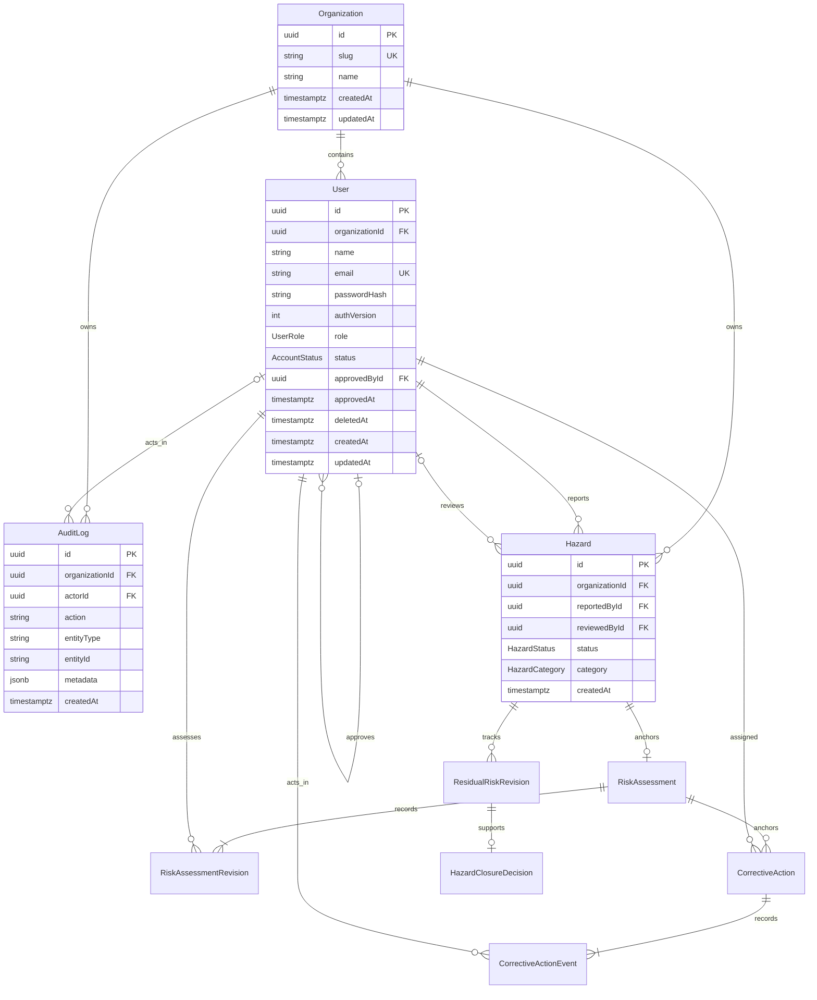

# SafeOps database design

## Models and constraints

- **Organization** identifies the tenant. Its slug is globally unique.
- **User** belongs to one organization and can reference an optional approving user in that organization. The creation model trims and lowercases email before writing. PostgreSQL enforces global uniqueness on the stored value. Other writers must use the same normalization. Prisma omits the password hash from normal user results by default.
- **AuditLog** records an organization event and may reference a user in that organization. A system event can omit the actor. Entity type and ID identify the subject without restricting it to one table. Metadata is limited to the `changedFieldCount` counter, the `automated` flag, and approved role labels on role-change events. Organization administrators can list and read records through the API.
- **Hazard** records a report, its reporter, and an optional reviewer. Composite foreign keys constrain both user relationships to the hazard's organization. Restrictive foreign keys preserve history. Indexes support organization, status, category, reporter, reviewer and creation-time lookups. See the [hazard management design](hazard-management-design.md) for the full model and lifecycle.
- **RiskAssessment** is the versioned record for one confirmed hazard. **RiskAssessmentRevision** stores each rating, server-calculated score and level, assessor ID, and timestamp. Composite keys enforce organization isolation. Check constraints enforce the ratings and scoring rules. See the [risk assessment design](risk-assessment-design.md) for the API and concurrency behavior.
- **CorrectiveAction** records assigned work for a confirmed, assessed hazard. Many actions can reference the same assessment. **CorrectiveActionEvent** stores the actor, status transition, and timestamp for every action version. Composite foreign keys scope the assessment and actor relationships to one organization. See the [corrective action design](corrective-action-design.md) for permissions and lifecycle details.
- **ResidualRiskRevision** stores remaining risk, its rationale, assessor and the baseline version and verified action count it covers. **HazardClosureDecision** stores one acceptance, escalation, or standard closure decision per residual version. The decision references that revision within the same organization. See the [hazard closure design](hazard-closure-design.md).
- All IDs are database-generated UUIDs. Creation timestamps default to the current time, and Prisma maintains the organization and user update timestamps. Timestamps use PostgreSQL `TIMESTAMPTZ(3)`.

Composite foreign keys match both organization and user IDs for approvers and audit actors. The unique user key on `(organizationId, id)` supports both relationships and tenant-scoped lookup. Foreign keys restrict deletes and referenced key updates. User indexes support organization/status/soft-deletion queries ordered by creation time and lookup by approver. Audit indexes support an organization's event timeline, actor lookup, and entity lookup.

## Organization isolation and soft deletion

Protected user operations take an organization ID from the authenticated context and exclude rows with `deletedAt`. The login lookup uses the globally unique email and is the only application model query that selects the password hash. Audit creation takes an organization ID independently of the optional actor. PostgreSQL enforces same-organization relationships even for writes outside Prisma. The application authorizes reads, and the composite foreign keys enforce referential isolation.

User deletion sets `deletedAt` to preserve approval and audit references. Soft-deleted users retain their email addresses in the global unique index. PostgreSQL restricts physical deletion while dependent records reference the row. Audit records have no public update or delete operations.

## Roles and account approval

| Role | Intended responsibility |
| --- | --- |
| `EMPLOYEE` | Participate in safety workflows |
| `SAFETY_OFFICER` | Coordinate and review safety work |
| `ADMIN` | Administer the organization and approve eligible accounts |

Public registration validates an explicit set of input fields, resolves the organization on the server, and supplies the password hash internally. The create model passes only organization ID, name, normalized email, and password hash to Prisma. PostgreSQL applies the `EMPLOYEE` and `PENDING` defaults. Registration and its audit record commit together. The local bootstrap transaction creates the first approved administrator through a separate model operation.

An administrator can approve another pending user, reject a pending non-administrator, suspend an approved non-administrator, or restore a suspended account in the same organization. Conditional updates and audit records share a transaction. Suspension and restoration increment the authentication version. Restoration preserves the original approval data.

## Why PostgreSQL and Prisma

PostgreSQL provides transactional writes, composite foreign keys, enums, UUIDs and JSONB. Prisma provides a declarative model, generated query client, and reviewable versioned migrations. SafeOps uses the PostgreSQL driver adapter and generates a JavaScript client for its ES module application.
