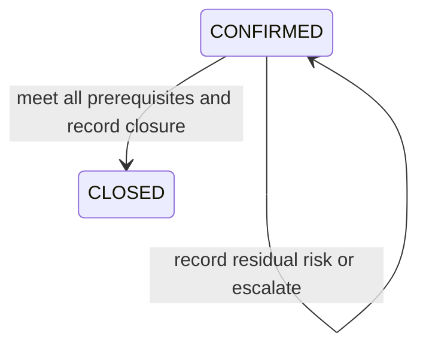

# Hazard closure and residual risk

## Workflow

A safety officer or administrator can record residual risk for a confirmed hazard once a baseline risk assessment exists and every corrective action is verified. At least one corrective action is required. Corrective actions use the existing independent verification rule. Residual revisions are stored separately from the baseline assessment and its revisions.

Send `version: 0` for the first residual assessment. Later submissions supply the current residual version and append a new immutable revision. Each revision records its assessor, timestamp, rationale, baseline version, and number of verified actions. Baseline changes or additional corrective actions require a fresh residual assessment before closure. Verified actions are terminal and the API provides no deletion, so the count identifies the set assessed.

| Remaining risk | Score | Closure policy |
| --- | --- | --- |
| Low | 1–4 | An officer or administrator can close with a rationale. Omit `decision`. |
| Medium | 5–9 | An officer or administrator can close with a rationale. Omit `decision`. |
| High | 10–16 | An administrator must explicitly accept it to close. An officer or administrator may escalate it. |
| Critical | 17–25 | An administrator must explicitly accept it to close. An officer or administrator may escalate it. |

Likelihood and severity are integers from 1 to 5. SafeOps multiplies them and assigns a level using the baseline scoring thresholds. PostgreSQL also checks the stored ratings, score, and level.

Escalation records the actor, rationale, and timestamp while keeping the hazard confirmed. A residual version supports one decision. Record a fresh revision after escalation before submitting another decision. Acceptance records the administrator's explicit decision and rationale. Use the rationale to explain the decision and evidence supporting it.



## API

All routes require a bearer token and use the standard JSON envelope.

| Method | Endpoint | Access and behavior |
| --- | --- | --- |
| `POST` | `/api/v1/hazards/:id/residual-risk` | Officer or administrator. Body has `version`, `likelihood`, `severity`, and `rationale`. Appends a revision and returns 201. |
| `GET` | `/api/v1/hazards/:id/residual-risk` | Anyone who can read the hazard. Returns the latest residual revision or 404 if none exists. |
| `GET` | `/api/v1/hazards/:id/residual-risk/history` | Same visibility. Uses `page` and `limit`, bounded to 10,000 and 100. Orders by version descending. |
| `PATCH` | `/api/v1/hazards/:id/close` | Officer or administrator. Body has `residualVersion`, `rationale`, and an optional `decision` of `ACCEPTED` or `ESCALATED`. Only administrators may accept. |
| `GET` | `/api/v1/hazards/:id/closure` | Same hazard visibility. Returns the latest recorded decision, including an escalation, or 404 if none exists. |

List closed hazards with `GET /api/v1/hazards?status=CLOSED`. Employees can read only the hazards they reported and the records tied to those hazards. A corrective-action assignment alone does not grant access to residual risk or closure. Invalid input returns 400. Missing prerequisites, stale versions, and repeat decisions return 409. Cross-organization and other inaccessible hazard IDs return 404.

```http
POST /api/v1/hazards/<hazard-id>/residual-risk
Authorization: Bearer <officer-token>
Content-Type: application/json

{"version":0,"likelihood":1,"severity":3,"rationale":"The verified controls reduced exposure to occasional inspections."}
```

```http
PATCH /api/v1/hazards/<hazard-id>/close
Authorization: Bearer <administrator-token>
Content-Type: application/json

{"residualVersion":2,"decision":"ACCEPTED","rationale":"Reviewed the high residual risk and accepted it for the documented operating conditions."}
```

Rationales require 10–4,000 UTF-16 code units after trimming and at least three letters or digits. Unknown fields are rejected. The decision response includes `hazardId`, `residualVersion`, `decidedById`, `createdAt`, `outcome`, `rationale`, and the status resulting from that decision.

## Consistency, audit, and scope

Residual writes, closure decisions, baseline revisions, and corrective-action writes lock the same organization-scoped hazard row. Closure checks prerequisites after obtaining that lock. If corrective-action creation wins first, its new open action blocks closure. If closure wins first, the competing write sees the closed hazard and fails. Residual and closure decisions use the expected version and fail on stale requests.

Closure status, decision records, and audit entries commit together. Residual and closure writes recheck the actor's account status, token version, and role under a database lock. Audit events identify the actor and hazard without storing rationale text in audit metadata. Restrictive, organization-scoped foreign keys protect assessor and decision-maker relationships. Closure is terminal through the API and freezes corrective actions and baseline and residual writes. Direct database writers must respect the same workflow rules. Escalation records the decision locally without sending notifications.
