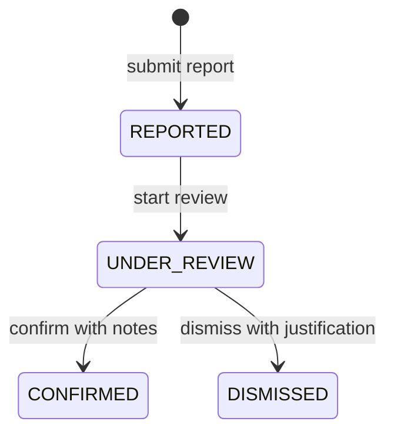
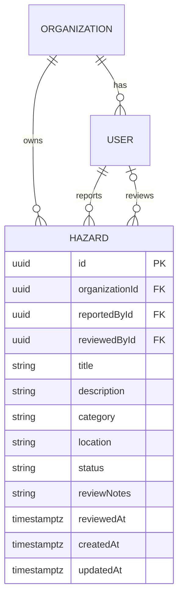

# Hazard management design

## Reporting and investigation

An approved user submits a report with a title, description, category, and location. SafeOps assigns the report to the signed-in user's organization and records that user as its reporter. A new hazard starts as `REPORTED`. The reporter can correct those four fields until investigation begins.

A safety officer or administrator starts review and is recorded as the reviewer. Starting review leaves `reviewedAt` empty. Either investigator role can later confirm or dismiss the report with notes. SafeOps records the person who made the final decision and sets `reviewedAt` at that point. The audit trail keeps the actors for both steps.



## Data model and organization isolation



Every query includes the organization from the authenticated user. Employee reads also match the reporter's ID. Reporter and reviewer foreign keys include the organization ID, so PostgreSQL rejects cross-organization relationships even outside the API. These relationships restrict physical deletion of organizations or users with historical hazards. Responses include reporter and reviewer IDs and hazard fields.

| Operation | Employee | Safety officer | Administrator |
| --- | --- | --- | --- |
| Report a hazard | Own organization | Own organization | Own organization |
| List or read | Own reports | All reports in own organization | All reports in own organization |
| Edit a reported hazard | Own report | Own report | Own report |
| Start review, confirm, or dismiss | Denied | Own organization | Own organization |

An inaccessible or missing hazard returns HTTP 404. An authenticated employee requesting an investigation action receives HTTP 403. An accessible hazard in the wrong state returns HTTP 409.

## API examples and validation

```http
POST /api/v1/hazards
Authorization: Bearer <access-token>
Content-Type: application/json

{
  "title": "Loose light cover",
  "description": "The protective cover on the work light is loose.",
  "category": "ELECTRICAL",
  "location": "Loading bay"
}
```

Example HTTP 201 response:

```json
{
  "success": true,
  "data": {
    "id": "fc24bf71-c2a4-4dec-9bcf-6ee4bd250312",
    "organizationId": "76c3c706-dc22-4bd2-bca5-80a54f31b521",
    "reportedById": "a41d28ce-21c3-4292-b6ef-d17baab65a94",
    "reviewedById": null,
    "title": "Loose light cover",
    "description": "The protective cover on the work light is loose.",
    "category": "ELECTRICAL",
    "location": "Loading bay",
    "status": "REPORTED",
    "reviewNotes": null,
    "reviewedAt": null,
    "createdAt": "2026-11-25T09:00:00.000Z",
    "updatedAt": "2026-11-25T09:00:00.000Z"
  }
}
```

```http
PATCH /api/v1/hazards/<hazard-id>/confirm
Authorization: Bearer <investigator-token>
Content-Type: application/json

{"reviewNotes":"Inspection confirmed the cover was loose at the reported location."}
```

- All JSON bodies use strict field allowlists. Supply a title of 1–160, a description of 1–4,000, and a location of 1–200 UTF-16 code units after trimming. Category is required at creation and must be one of `ELECTRICAL`, `CHEMICAL`, `FIRE`, `MECHANICAL`, `ERGONOMIC`, `BIOLOGICAL`, `PHYSICAL`, `PSYCHOSOCIAL`, `ENVIRONMENTAL`, or `OTHER`.
- An edit must include at least one of those four fields. A review-start request accepts an empty object or no body. A final decision accepts only `reviewNotes`, with 10–2,000 code units after trimming and at least three Unicode letters or digits.
- List filters include `category`, `status`, `location`, `search`, `from`, and `to`. Location is a case-insensitive literal substring match. Search matches title or description the same way. Dates filter creation time and are inclusive ISO 8601 timestamps with offsets. Search supports 1–200 code units. Pagination defaults to page 1, limit 20, with bounds of 10,000 and 100. Sort order is descending creation time and descending ID.

## Transactions, audit, and limitations

PostgreSQL checks the expected status as part of each update. If review starts first, an edit fails. Confirm and dismiss both require `UNDER_REVIEW`, so only one final decision succeeds. Each mutation and its audit entry commit together. Audit events record the actor, organization, action, and hazard ID. Report details and review notes stay out of audit metadata.

Investigators may hand off reviews within the organization. The report stores the final reviewer and the audit log records the person who started the review. Notes are visible to anyone authorized to read the hazard, including its reporter. Offset pagination can shift when records are inserted between requests. Investigation ends at confirmation or dismissal. Confirmed hazards can proceed through the [closure workflow](hazard-closure-design.md).
