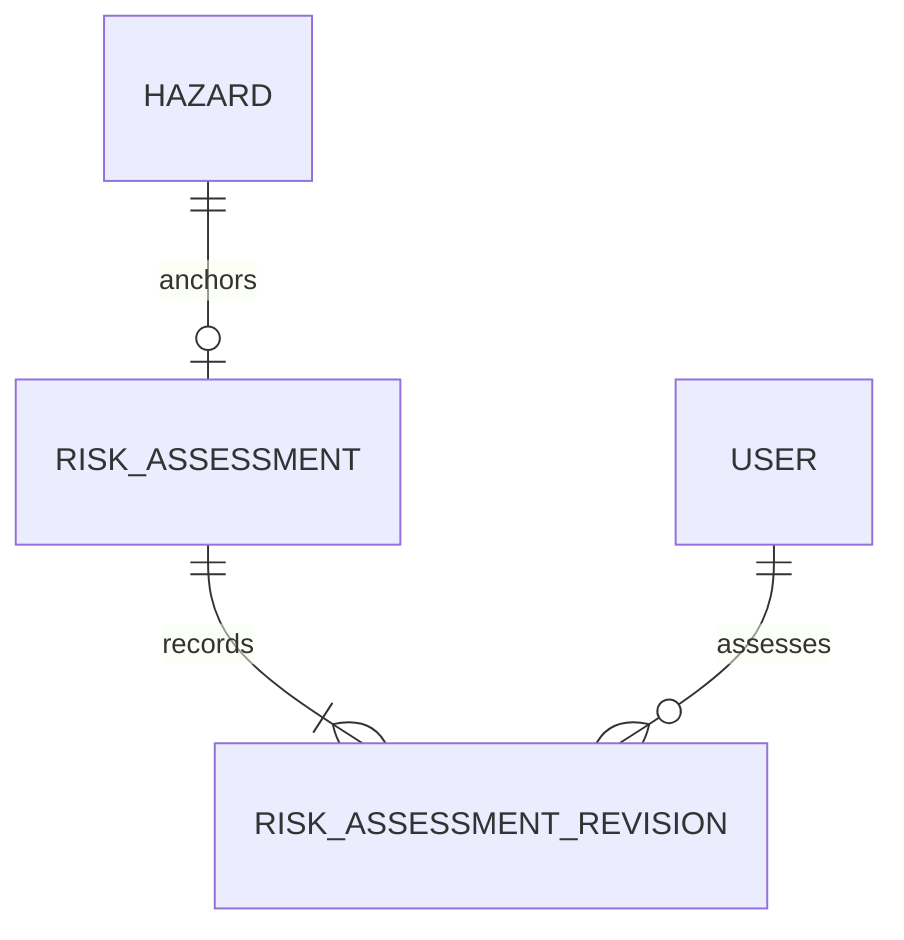

# Risk assessment design

## Workflow and scoring

A safety officer or administrator can assess a confirmed hazard in their organization. Each hazard has one assessment with an initial revision and any later revisions. Employees can read an assessment and its history when they can read its hazard.

Likelihood rates how probable harm is, from 1 (rare) to 5 (almost certain). Severity rates how serious the harm would be, from 1 (minor) to 5 (catastrophic). Both ratings must be JSON integers. Assign them from the available workplace evidence. The score is their product.

| Score | API level |
| --- | --- |
| 1–4 | `LOW` |
| 5–9 | `MEDIUM` |
| 10–16 | `HIGH` |
| 17–25 | `CRITICAL` |

The score bands are SafeOps defaults. Some integers in these intervals cannot result from multiplying two ratings of 1–5.

## API

All endpoints require a bearer token and return the existing JSON envelope. Inaccessible records return 404.

| Method and path | Behavior |
| --- | --- |
| `POST /api/v1/risk-assessments` | Safety officer or administrator. Accepts only `hazardId`, `likelihood`, and `severity`. Returns 201 with version 1. A duplicate or unconfirmed hazard returns 409. |
| `GET /api/v1/risk-assessments` | Lists visible assessments, optionally filtered by `hazardId`. |
| `GET /api/v1/risk-assessments/:id` | Returns the current revision and assessment identifiers and timestamps. |
| `PATCH /api/v1/risk-assessments/:id` | Safety officer or administrator. Requires the current `version` and at least one rating. Returns 409 for a stale version. |
| `GET /api/v1/risk-assessments/:id/history` | Returns revisions from highest version to lowest, including assessor ID, ratings, score, level, and creation timestamp. |

```http
POST /api/v1/risk-assessments
Authorization: Bearer <assessor-token>
Content-Type: application/json

{"hazardId":"9c6354f8-8a58-439d-a62e-564cad5bfd13","likelihood":3,"severity":4}
```

The response includes `version: 1`, `score: 12`, `level: "HIGH"`, the assessor's ID, and assessment and revision timestamps. Use the current version to submit another rating.

```http
PATCH /api/v1/risk-assessments/<assessment-id>
Authorization: Bearer <assessor-token>
Content-Type: application/json

{"version":1,"severity":5}
```

List and history responses accept `page` and `limit`. Defaults are page 1 and 20 records, with maximums of 10,000 and 100. Assessment lists sort by creation timestamp and ID, descending. History sorts by version, descending. An explicit invisible or nonexistent hazard filter returns 404.

## Persistence and concurrency



The application checks that a hazard is confirmed before assessment. Baseline revisions are frozen once the hazard is closed. PostgreSQL enforces same-organization links to hazards and assessors, uniqueness per hazard and revision version, and rating, score, and level consistency. Restrictive foreign keys protect history. API responses expose identifiers and assessment fields without joining user profiles.

Creation writes the assessment, revision, and audit event together. An update first advances the version with a conditional database write, then appends the new ratings and audit event in the same transaction. A concurrent request using the same expected version receives 409 and can fetch the latest revision. Reads use a consistent database snapshot so an assessment's version and current ratings agree. Audit records identify the actor and assessment, with no free-text metadata.

The API has no assessment deletion or history-edit endpoint. The database uses one current baseline assessment per hazard and the existing offset pagination. New records can shift subsequent pages. Platform operators with direct database write access remain responsible for respecting workflow rules. The [hazard closure workflow](hazard-closure-design.md) keeps residual risk separate from the baseline.
